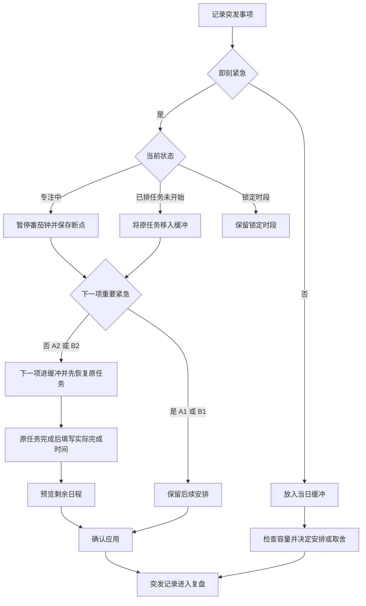

# 竞赛拆解、突发处理与复盘

导入周课表时核对学期第 1 周日期、每门课起止周和每周／单周／双周。奇偶以学期周序号为准。没有具体上课时刻的节次需用户补填，未排课课程不写入固定时段。预览确认后才按周生成日程。

| 入口 | 输入 | 确认点与数据去向 |
| --- | --- | --- |
| AI 拆解 → 资料与规则 | 官方公告或知识库资料 | 核对报名与作品提交截止、时区、格式、材料和原文出处。确认后保存规则至项目知识库。 |
| AI 拆解 → 作品差距 | 目标、当前作品、可选对标资料、能力自评、证据、每日投入 | 查看已具备、缺证据、需补齐三类结论。只勾选本轮要补齐的建议，确认差距后再生成任务草稿，正式排期另行确认。 |
| 临时收集／今日时间表／番茄钟 → 突发任务与当日缓冲 | 等级、预计分钟、是否涉及核心目标、断点 | 紧急事项保存断点。恢复方案需预览并确认，更新当日日程和缓冲记录。 |
| 复盘 | 日期、实际耗时、补充、突发与取舍记录 | 分清排期、实耗与自评。确认后将复盘存入项目知识库。 |

缓冲默认 17:00 至 18:00，可按日期修改。用分钟判断容量，安排时避开课表及其他占用。超量时优先检查非核心或耗时长的事项，由用户决定是否舍弃。舍弃后 24 小时内可恢复到原日期的缓冲箱。历史缓冲不会自动滚到下一天。

处理紧急事项前，记录已完成内容、当前步骤和恢复时的下一步。使用工作台时，用户在突发面板填写断点，绑定任务和番茄钟剩余时间由界面带入。处理完后，打开突发面板选择是否保留下一个任务，再预览并确认。B 分支适用于已分配时段、仍可移动的任务。课表等锁定时段需先由用户调整。

如果用户要求协助取舍，先核对时间窗口与当前核心目标，再从重要性和紧急性判断，优先提出移除非核心、低价值或超出当日容量的事项。保留硬截止和核心完成，由用户确认取舍。用户反复调整细节却迟迟未确定时，可提醒「完成比完美更重要」，并给出能完成的最小安排。

返回项目排期或今日时间表时，工作台提示处理中的突发。容量不足或窗口结束时，按照核心标记、已有任务截止日与耗时列出取舍建议。缺少明确截止日时按可暂缓处理，可由用户结合上下文修正。A2/B2 首次确认只恢复原任务并移走下一项。用户随后填写实际完成时间并确认第二次预览，才调整剩余日程。处理面板打开并等待两分钟后会给出简短提醒。

如果工作台无法读取公告、缺少作品证据，或排期在预览后变化，先提示缺口或重新生成预览。仅凭模型建议无法确认官方期限、实际耗时或能力水平。

执行日和硬截止日分别核对。待分配事项只有明确截止日并在池中停留超过 72 小时，才出现在项目风险的对应分组。估时先看同项目同类任务实耗和样本数，再核对该项目的每日预算以及当天已排时间。复盘中的同类项目趋势可用来核对投入变化。确认后的拆解笔记和资料转待办来源会补默认分类，已有手动归档保留原位置。

需要核对拖拽排期与工时回写时，进入项目知识库的「任务执行／每日记录」。同一项目同一天共用一份记录，排期操作与实耗分节显示。同一天重新登记同一任务的实耗会更新对应条目，复盘时以实际耗时部分为准。

每日复盘按行动、产出、逐项耗时、取舍、时间改进五问依次输出。工作台展示所选日期的日历页，归档和 Markdown 沿用同样的标题顺序。资料缺少的题目标注待补充。

番茄钟的完成数量按完成日统计，已绑定任务的工时按本次专注开始日期记账。跨午夜或隔日确认时，以待入账面板显示的日期为准，不把旧记录自动记到确认当天。复盘核对对应日期的工时；完成番茄数不直接等于任务已完成。

月总览的左侧项目卡同时展示本月排期和未排期事项。虚线标签进入该项目待分配池，不能把未排事项当作已经落在月历中。完成进度仅统计本月显示的执行项，「本月事项已完成」也不表示整个项目已经结案。AI 助理的示例短句只填入输入框，仍需发送和核对预览；今日安排、项目拆解、每日复盘卡片打开对应功能，不会直接修改日程。

需要同时查看今日安排时，可在任务中心、知识库或 AI 等页面展开右侧「今日任务看板」。按五大类、具体项目、任务逐层展开；固定课程在「固定时段」中查看。这里展示跨项目当天未完成事项，点击「打开今日时间表」进入完整时间轴。看板只读，不会因展开、收起或跳转修改排期；窄屏时位于正文下方。没有明确钟点的任务显示「当天待排」。
